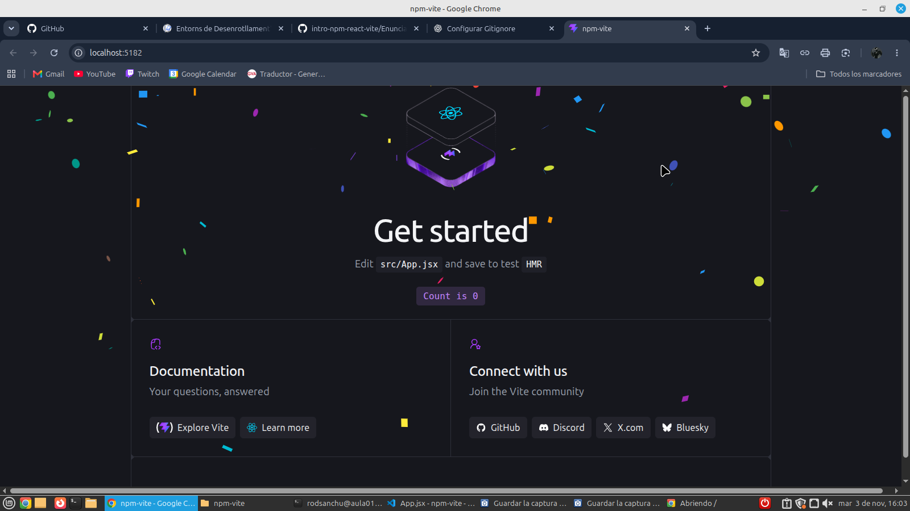
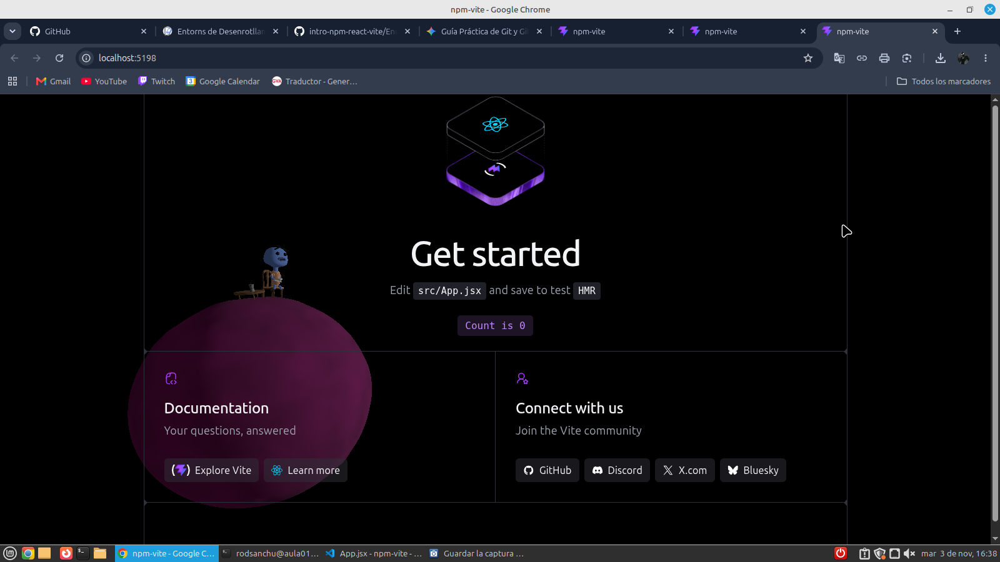
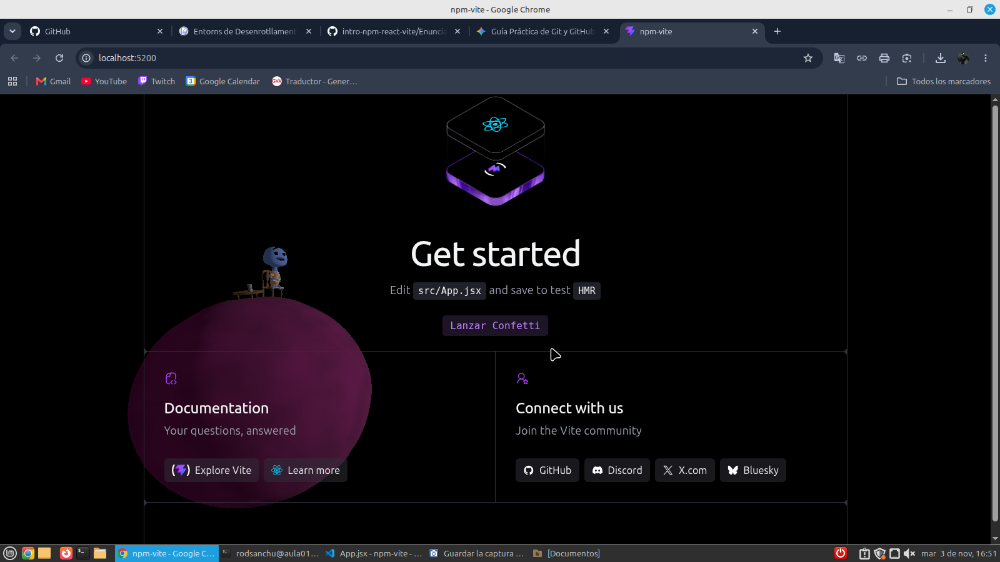

## Aqui esta la captura del confetti solo.

## Aqui esta la captura del boton confitero.

## Aqui tienes la captura del PlanetScene.

## Aqui tienes la captura de todo junto con merge.

## Si la carpeta node_modules/ está excluida, ¿borrar una dependencia hace alguna acción sobre el repositorio? ¿Cuál?

>Sí, borrar una dependencia si que hace acciones sobre el repositorio. Aunque la carpeta node_modules/ esté excluida en el .gitignore y no se suba, lo que pasa es que se actualizan y modifican los archivos package.json y package-lock.json. Como Git sí rastrea estos archivos de configuración, detecta que la librería ya ha sido eliminada y te aparecen los cambios en el git status listos para hacerles commit y subirlos al remoto.

## Aqui tienes el link de mi page de github.
>https://rodrigosantamaria24.github.io/Actividad-web-npm/